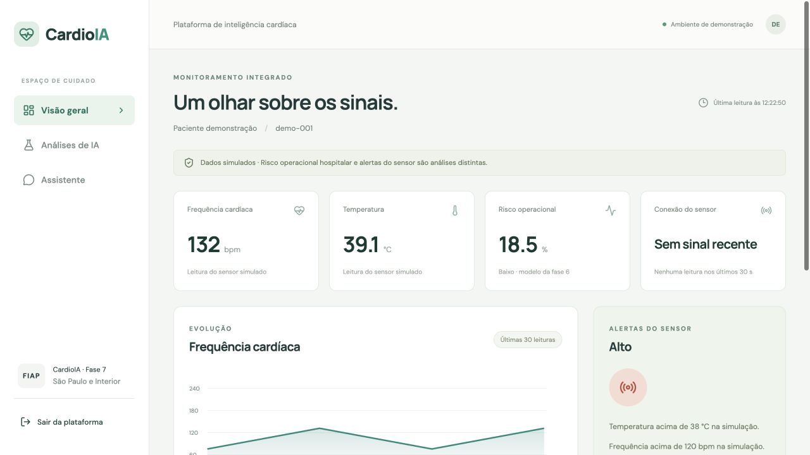
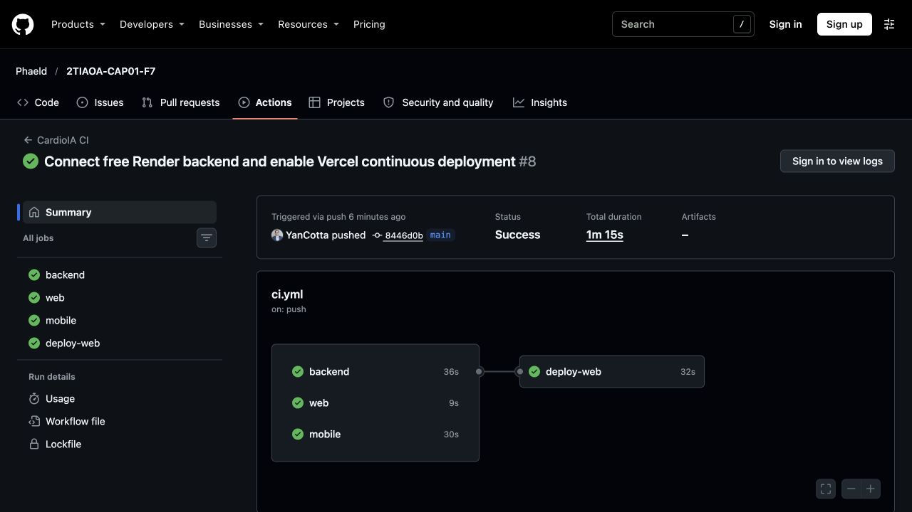
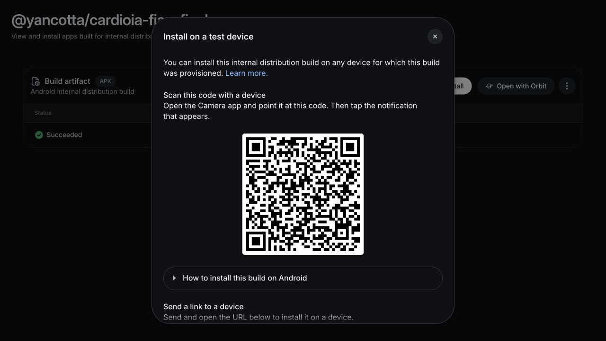

# CardioIA - Fase 7

**Coração Sob Controle: da construção de módulos à solução integrada.** MVP acadêmico com sensores simulados, IA e interfaces Web/Android sobre um serviço Python.

> Somente dados simulados. O modelo F6 estima risco operacional hospitalar sintético, não risco individual de infarto. Não é dispositivo médico nem substitui avaliação profissional.

## Estado da entrega

Web e backend publicados, Gemini validado e APK assinado gerado. Testes locais e CI/CD remoto aprovados. Instalação em Android físico, Wokwi, vídeo e fechamento da entrega ainda precisam ser concluídos. Estado detalhado em [docs/DELIVERY.md](docs/DELIVERY.md).

| Entregável | Link / estado |
|---|---|
| Web Vercel | https://cardioia-fiap-final.vercel.app |
| Backend | https://cardioia-api-6efu.onrender.com/docs |
| EAS / APK | [Build concluído / QR](https://expo.dev/accounts/yancotta/projects/cardioia-fiap-final/builds/01b49027-ce04-4310-8c76-30e3ada07c04) · [Baixar APK](https://expo.dev/artifacts/eas/FaDIB1IArS8CZvkOeWZqxYtCvV3GeZZCKNhp7r080Qg.apk) |
| Wokwi | Raphael; [handoff](IoT/README.md) |
| Relatório | [PDF técnico](docs/relatorio-tecnico.pdf), rascunho a fechar com evidências |
| Vídeo até 5 min | Pendente; [roteiro](docs/DELIVERY.md) |

Login publicado: `demo@cardioia.local`. Solicitar a senha e a chave IoT a Yan por canal privado. O perfil gratuito pode suspender por inatividade; abrir [health](https://cardioia-api-6efu.onrender.com/health) antes da demonstração e aguardar `status: ok`. Histórico efêmero; visão F4 disponível apenas localmente.

### Evidências do deploy

[CI/CD por push aprovado](https://github.com/Phaeld/2TIAOA-CAP01-F7/actions/runs/41214343191), [API pública: 16 verificações](docs/evidence/public-api-validation.json) e [APK: validação do arquivo](docs/evidence/apk-validation.json).




## Grupo São Paulo e Interior

- Jonas Tadeu V. Fernandes - RM563027
- Levi Passos Silveira Marques - RM56557
- Raphael da Silva - RM561452
- Raphael Dinelli Neto - RM562892
- Yan Pimental Cotta - RM562836

Tutor: Caique Nonato da Silva Bezerra. Coordenador: André Godoi. Prazo: **10/11/2026**. Divisão confirmada: Yan (integração/deploy/interfaces), Raphael (MicroPython/Wokwi); revisão, teste físico e vídeo pelo grupo. Confirmar dados dos integrantes antes da entrega.

## Arquitetura e documentos

```text
Sensor → MicroPython/Wokwi → API Python → IA → Web / APK
              ↑                 ↕          ↳ Gemini + corpus F1
              └─ LED/OLED        SQLite
```

- [Arquitetura e decisões](docs/ARCHITECTURE.md)
- [Roadmap e critérios de aceite](docs/ROADMAP.md)
- [Auditoria das seis fases](docs/MIGRATION.md)
- [Origem e checksums](docs/migration-manifest.json)
- [Enunciado FIAP](docs/FIAP-requirements.txt)
- [Deploy e instalação](docs/DEPLOYMENT.md)

`Backend/`: FastAPI, risco, NLP, Gemini, ResNet50 opcional, SQLite. `Web/`: React/Vite. `Mobile/`: React Native/Expo. `IoT/`: contrato/helper para Raphael. `docs/`: arquitetura, fontes, PDF e evidências. `.github/workflows/ci.yml`: testes e builds por push/PR.

## Executar localmente

Python 3.12 e Node 22.12+.

```bash
git clone https://github.com/Phaeld/2TIAOA-CAP01-F7.git
cd 2TIAOA-CAP01-F7
python3.12 -m venv .venv
source .venv/bin/activate
pip install -r Backend/requirements-dev.txt
python scripts/setup_local.py
PYTHONPATH=Backend uvicorn cardioia.main:app --host 127.0.0.1 --port 8000
```

O setup gera credenciais aleatórias em `.env` (ignorado pelo Git). Login: `demo@cardioia.local`, senha em `CARDIOIA_DEMO_PASSWORD`. Não existe senha pública fixa. Gemini: definir `GEMINI_API_KEY` nesse arquivo ou executar `python scripts/configure_services.py`. Sem chave, chat informa modo local.

Em outro terminal:

```bash
cd Web
npm ci
npm run dev
```

Abrir http://127.0.0.1:5173, entrar e gerar leituras. OpenAPI: http://127.0.0.1:8000/docs. Proxy Vite encaminha `/api` para o backend local.

### Visão da fase 4

```bash
pip install -r Backend/requirements-vision.txt
# definir CARDIOIA_VISION_ENABLED=true no .env e reiniciar backend
```

ResNet50 treinada versionada; sem Kaggle ou retreino. Upload PNG/JPEG até 5 MB / 16 megapixels. TensorFlow exige memória adicional: consultar perfil completo no guia de deploy.

### Mobile

```bash
cd Mobile
npm ci
cp .env.example .env
# definir EXPO_PUBLIC_API_URL com a URL HTTPS pública
npx expo start
```

O [APK assinado](https://expo.dev/artifacts/eas/FaDIB1IArS8CZvkOeWZqxYtCvV3GeZZCKNhp7r080Qg.apk) foi gerado por EAS, com pacote `br.com.cardioia.fiap` e a API pública incorporada.

1. Abrir o [build / QR de instalação](https://expo.dev/accounts/yancotta/projects/cardioia-fiap-final/builds/01b49027-ce04-4310-8c76-30e3ada07c04) no Android e baixar o APK.
2. Permitir a instalação desse arquivo pelo navegador quando o Android solicitar.
3. Instalar CardioIA, entrar com `demo@cardioia.local` e a senha fornecida por Yan.
4. Gerar uma leitura na Web ou Wokwi e confirmar os mesmos valores no APK após cerca de 5 segundos. Testar também o assistente.
5. Registrar aparelho, versão Android, data, resultado e print em `docs/evidence/`. Esse teste físico será feito por Raphael/grupo e continua pendente.



Para um novo build: `eas build --platform android --profile preview`, seguindo o [guia](docs/DEPLOYMENT.md). Imagem fica desativada no perfil hospedado gratuito.

### Sensor sem hardware

```bash
.venv/bin/python scripts/simulate_sensor.py
.venv/bin/python scripts/simulate_sensor.py --alert
```

O contrato de Raphael está em [IoT/README.md](IoT/README.md). `transport.py` não inclui pinagem ou simulação completa.

## Verificação

```bash
.venv/bin/python -m pytest -q
npm ci --prefix Web && npm run build --prefix Web
cd Mobile && npm ci && npx expo install --check && npx expo export --platform android
```

Validação local inicial: **27 testes**, build Web e bundle Android passando; ResNet50/Grad-CAM executados em smoke de runtime. Gemini validado também na API pública e na Web; 16 verificações públicas passaram. [Evidências](docs/DELIVERY.md).

## Checklist FIAP

- [x] Código React/Vite, React Native/Expo e Python integrados.
- [x] `vercel.json` SPA, `app.json` domínio invertido, `eas.json` preview/APK.
- [x] Contrato, arquitetura, migração e roadmap.
- [x] Vercel pública e CI/CD Git comprovados.
- [x] Backend público e Gemini real validados no perfil gratuito.
- [ ] Hospedagem da visão F4: adiada por decisão do grupo; runtime local validado.
- [x] Link EAS e APK assinado acessíveis.
- [ ] Instalação e teste em Android físico (Raphael/grupo).
- [ ] `IoT/main.py`, Wokwi público e LED/OLED (Raphael).
- [ ] PDF final ≤5 páginas, prints e vídeo ≤5 min.
- [ ] Repositório **privado** compartilhado com tutor (proprietário Phaeld).

## Autoria e licenças

Mantida a licença do repositório/template FIAP. Fontes migradas preservam autoria em `docs/origins`; manifesto identifica cada origem. Dados/modelos das entregas anteriores são usados no contexto acadêmico, sem alegação de validação clínica.
