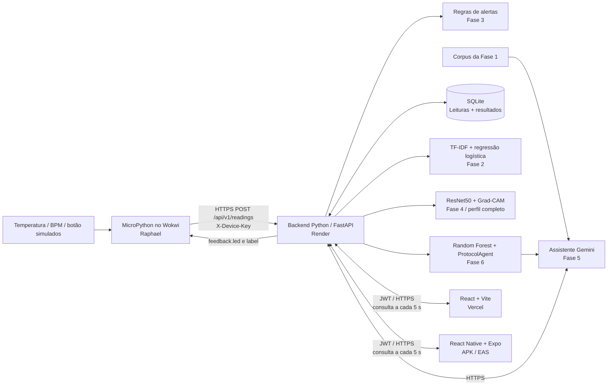

# Arquitetura final CardioIA

## Decisão: um backend, duas interfaces, um contrato de sensores

O MVP mantém um único serviço Python/FastAPI. React + Vite é publicado na Vercel; React Native + Expo gera APK pelo EAS. As duas interfaces consomem `/api/v1`. SQLite registra as leituras e suas análises. Não há microserviços, broker MQTT, Kubernetes, fila ou banco externo no escopo básico.

## Responsabilidades e limites

- **Backend integrador (Yan):** autenticação de demonstração, validação do contrato, persistência, adaptação dos modelos, endpoints de IA e documentação OpenAPI.
- **IoT (Raphael):** sensores, pinagem, captura MicroPython, Wi-Fi, retries e LED/OLED no Wokwi. O transporte HTTP e o contrato estão disponíveis em `IoT/`.
- **Web e Mobile (Yan):** login, indicadores, atualização periódica, estados de erro, assistente e upload de radiografia.
- **Grupo:** teste do APK em aparelho físico, vídeo de até 5 minutos, revisão do relatório, links públicos e compartilhamento do repositório privado com o tutor.

## Fluxo de leitura

1. MicroPython produz um evento com ID único por amostra. Temperatura em °C e frequência em bpm.
2. O dispositivo envia JSON autenticado; a chave só pode enviar para `esp32-001` / `demo-001` (configuráveis).
3. O backend valida faixa, tipos, timestamp e identidade; calcula os alertas da fase 3 e o risco operacional da fase 6.
4. O evento completo é gravado de forma atômica. Repetir o mesmo ID e payload retorna o mesmo evento; mudar o payload com o mesmo ID retorna 409.
5. A resposta inclui `feedback.led`: `green`, `yellow` ou `red`. Reflete as regras do sensor, não o risco hospitalar.
6. Web e APK consultam `/dashboard` a cada 5 segundos. Leituras com mais de 30 segundos são marcadas como antigas; eventos atrasados não substituem a leitura mais recente.

## Semântica do modelo da fase 6

O artefato original (`risk_model.joblib`, scikit-learn 1.9.1) prevê **pico de risco operacional sintético**. Não foi treinado como diagnóstico individual. Das dez features, `average_hr` e `temperature` recebem a amostra simulada; `average_spo2` e `systolic_bp` podem ser enviados opcionalmente. As demais são constantes de um cenário de demonstração: idade média 62, ocupação 65%, espera 30 min, densidade 3, eventos/24h 2, recursos 70%; SpO₂ padrão 97%, PA padrão 120.

Cada feature tem origem explícita no JSON e no painel. Usar uma amostra no lugar de uma média agregada é uma **adaptação didática**, não equivalência estatística. A temperatura original foi gerada com média 24 °C; portanto também há diferença de distribuição. Não se reivindica validade clínica ou calibração de probabilidades.

O Random Forest e `ProtocolAgent` são reutilizados diretamente. A ordem dos agentes é executada pelo Python de forma determinística, dispensando chamadas LLM para decidir funções já conhecidas. O Gemini explica os resultados somente quando solicitado no chat, usando o resultado real, o timestamp e trechos recuperados da fase 1. O pipeline original do Agents SDK foi preservado como referência; não se afirma que os handoffs LLM originais são executados nesta API.

## Segurança e funcionamento básico

Somente um usuário e paciente de demonstração; sem prontuários reais, cadastro público ou papéis clínicos. A senha é definida por variável de ambiente; login emite JWT de 2 horas. Web guarda token em `sessionStorage`; mobile em SecureStore. Tokens inválidos/expirados encerram a sessão. Chave de dispositivo não autentica usuários. CORS aceita apenas origens configuradas, limites de corpo e de chamadas reduzem abuso; o backend não envia e-mail, SMS nem aciona serviços de saúde. A chave Gemini permanece no servidor.

## Hospedagem

`render.yaml` oferece o perfil gratuito para os módulos leves. A visão TensorFlow é ativada no perfil completo, com `ENABLE_VISION=true` no build e `CARDIOIA_VISION_ENABLED=true` no runtime; requer memória adicional. O smoke local de inferência atingiu aproximadamente 836 MB no macOS, sem servir como benchmark Linux. O plano gratuito de 512 MB é insuficiente para essa configuração completa. Não mascarar a visão desativada como disponível.

SQLite no disco efêmero do Render perde histórico em reinícios/deploys. Para a entrega completa, usar disco persistente de 1 GB em `/app/data` e uma instância com pelo menos 2 GB. Um único worker mantém a configuração simples. Não provisionar plano pago sem autorização do responsável.

## Referências de configuração

- [Vercel: rewrites SPA](https://vercel.com/docs/project-configuration/vercel-json)
- [Expo: perfil APK](https://docs.expo.dev/build-reference/apk/)
- [Render: planos de computação](https://render.com/docs/compute-plans)
- [Render: persistência de disco](https://render.com/docs/disks)
- [Gemini: generateContent](https://ai.google.dev/api/generate-content)
- [Wokwi: conectividade ESP32 / MicroPython](https://docs.wokwi.com/guides/esp32-wifi)
